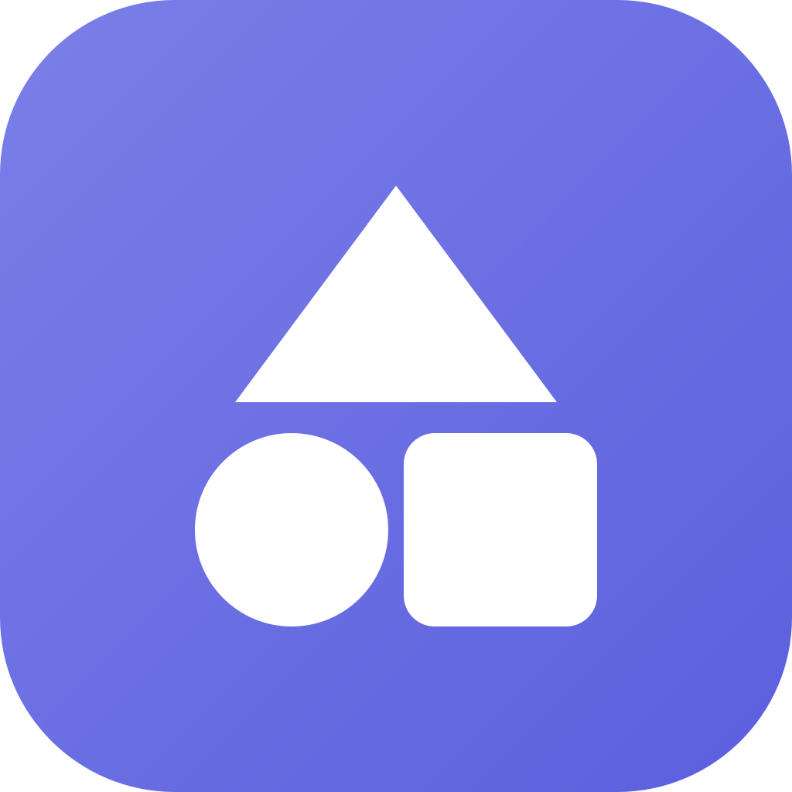

# Orion Store for PC (Windows)

<p align="center">
  
</p>

<p align="center">
  A native Windows desktop client for <strong>Orion Store</strong>, engineered in <strong>C#</strong>, <strong>.NET</strong>, <strong>WinUI 3</strong>, and the <strong>Windows App SDK</strong>.<br>
  Transparent public catalog, multi-source release resolution, zero tracking, and strict security verification.
</p>

<p align="center">
  <a href="#prerequisites"></a>
  <a href="#running-the-unit-tests"></a>
  <a href="#license--credits"></a>
  <a href="https://github.com/RookieEnough/Orion-Store"></a>
</p>

---

## Highlights & Features

### 🖥️ Native Windows Fluent Design
- Built from the ground up for desktop using **WinUI 3** and **Windows App SDK 1.6**.
- Implements modern Windows 11 Fluent styling: **Mica backdrop**, responsive NavigationView, custom TitleBar, dark/light theme switching, and keyboard navigation.

### 🌐 Cross-Platform Device Switcher & Strict Windows Enforcement
- **Device Switcher:** Seamlessly switch catalog views across **Windows (Default)**, **Android**, **Linux**, **macOS**, and **All**.
- **Dual-Layer Guardrails:**
  - **UI State:** When browsing non-Windows apps, Download and Install actions are completely replaced by an informative **"Not available on Windows"** banner with safe external links (*View on GitHub / GitLab / Official Site*, *Copy Link*).
  - **Service-Layer Enforcement:** Both `DownloadManager` and `WindowsInstallerService` programmatically validate and reject any non-Windows assets even if the UI were bypassed.

### 📦 Smart Install Tiers & Architecture Selection
- **Install Tiers:**
  - **Tier A (Direct Release Install):** Resolves releases from GitHub repositories, identifies Windows binary assets (`.exe`, `.msi`, `.msix`, `.zip`), and enables direct one-click installation.
  - **Tier B (Direct File URL):** Handles direct binary file URLs with checksum verification.
  - **Tier C (Official Website):** For web portals or repository mirrors without binary releases, presents a clear **"Open official download page"** action without scraping or guessing.
- **Hardware Architecture Detection:** Automatically queries the machine architecture (`x64`, `ARM64`, `x86`) and ranks compatible packages, offering users the recommended binary while preserving the ability to select alternative package formats.

### 🛡️ Enterprise-Grade Desktop Security
- **Authenticode Signature Verification:** Automatically inspects embedded digital signatures (`X509Certificate2`) for downloaded PE binaries (`.exe`, `.msi`), displaying signer information, validity status, or explicit **"Unsigned"** warnings before execution.
- **SHA-256 Hash Verification:** Computes and verifies SHA-256 checksums against catalog and release metadata.
- **Zip-Slip Traversal Prevention:** Hardened ZIP extraction routines normalize paths and enforce directory boundary confinement.
- **Credential Protection:** VirusTotal API keys and optional GitHub Personal Access Tokens are stored securely using Windows **DPAPI** and **PasswordVault**, never in plain text.
- **Zero Telemetry:** No analytics, no advertising SDKs, and no tracking cookies.

### 🔍 Windows App Detection & Tracking
- Scans installed applications across 64-bit and WOW6432Node Windows Registry keys (`HKLM` and `HKCU`).
- Enumerates modern WinRT/UWP packages via `Windows.Management.Deployment.PackageManager`.
- Maintains a local tracking database (`%LocalAppData%\OrionStore\installed_portable.json`) for portable applications installed by Orion Store.

### ⚡ Offline Reliability & Resilience
- Multi-mirror remote fetching with automatic fallback to local disk cache (`%LocalAppData%\OrionStore\Cache\cached_catalog.json`) and an embedded catalog (`Assets/local_apps.json`).

---

## Project Architecture

```
d:\vs code\Orion-Store-main/
├── Orion PC/                     # Native Windows Desktop Application
│   ├── Orion.slnx                # Visual Studio / .NET Solution
│   ├── ARCHITECTURE.md           # Detailed Windows Architecture & Porting Specs
│   ├── README.md                 # Orion PC Specific Instructions
│   ├── src/
│   │   ├── Orion.Core/           # Platform-agnostic C# domain logic (.NET 8)
│   │   │   ├── Models/           # AppItem, TargetPlatform, InstallTier, StoreConfig
│   │   │   └── Services/         # PlatformParser, AssetResolver, VersionService, HashVerifier
│   │   ├── Orion.Platform.Windows/ # Windows SDK / WinRT integrations (.NET 8 Windows)
│   │   │   └── Services/         # WindowsAppTracker, WindowsInstallerService, DownloadManager
│   │   └── Orion.App/            # WinUI 3 Application (Windows App SDK 1.6, .NET 10/8)
│   │       ├── Views/            # HomePage, SearchPage, AppDetailPage, MyAppsPage, etc.
│   │       └── ViewModels/       # MVVM ViewModels with CommunityToolkit.Mvvm
│   └── tests/
│       └── Orion.Tests/          # xUnit Test Suite (85 automated tests)
├── app/                          # Original Android Client (Kotlin, Jetpack Compose)
└── Orion Legacy/                 # Original Web Client (React + Capacitor)
```

---

## Prerequisites

- **Operating System:** Windows 10 (version 1809 / build 17763 or higher) or Windows 11 (x64 / ARM64).
- **Tooling:**
  - [.NET SDK 8.0](https://dotnet.microsoft.com/download/dotnet/8.0) or [.NET SDK 10.0](https://dotnet.microsoft.com/)
  - [Visual Studio 2022](https://visualstudio.microsoft.com/) (v17.8+) with *.NET Desktop Development* and *Windows App SDK C# Templates*, or the **.NET CLI**.
  - [Windows App SDK 1.6 Runtime](https://learn.microsoft.com/en-us/windows/apps/windows-app-sdk/downloads).

---

## Build, Test & Run

### 1. Build Solution
```powershell
dotnet build "Orion PC/Orion.slnx"
```

### 2. Run Automated Tests
Execute the comprehensive test suite (covers catalog filtering, platform parsing, install-tier classification, architecture ranking, hash checking, and security enforcement):
```powershell
dotnet test "Orion PC/tests/Orion.Tests/Orion.Tests.csproj"
```
*(85 tests passing)*

### 3. Run Application (Unpackaged)
Launch the WinUI 3 desktop client directly:
```powershell
dotnet run --project "Orion PC/src/Orion.App/Orion.App.csproj"
```

---

## Publishing & Packaging

### Standalone Self-Contained Binary
Produce a portable, single-folder release for 64-bit Windows:
```powershell
dotnet publish "Orion PC/src/Orion.App/Orion.App.csproj" -c Release -r win-x64 --self-contained -p:WindowsPackageType=None
```
Output path: `Orion PC/src/Orion.App/bin/Release/net10.0-windows10.0.26100.0/win-x64/publish/Orion.App.exe`

### MSIX Package
In `Orion.App.csproj`, set `<WindowsPackageType>MSIX</WindowsPackageType>` and run:
```powershell
dotnet publish "Orion PC/src/Orion.App/Orion.App.csproj" -c Release -r win-x64 /p:GenerateAppInstallerFile=false /p:AppxPackageSigningEnabled=false
```

---

## Porting Decisions from Android

| Android Feature | Windows Equivalent | Status & Decision |
|---|---|---|
| **Android PackageManager** | `WindowsAppTracker` (4-way Registry + WinRT + Portable DB) | **Replaced** with comprehensive Windows software detection. |
| **Shizuku / Root / ADB** | `WindowsInstallerService` (.exe, .msi, .msix, safe .zip) | **Replaced** with standard Windows UAC and installation handlers. |
| **Foreground Download Service** | `DownloadManager` with HTTP Range resume & JSON queue | **Replaced** with desktop background download manager. |
| **Android Debloater (Guardian)** | None | **Dropped** (inapplicable to Windows OS architecture; avoids risky registry tampering). |
| **Unity Ads SDK (Fuel the Code)** | None | **Dropped** (desktop application maintains zero ads and zero telemetry). |
| **Material 3 Expressive UI** | WinUI 3 Fluent Design (Mica, custom TitleBar, NavigationView) | **Rebuilt** natively for Windows desktop user experience. |

---

## License & Credits

- **License:** Orion Store for PC is licensed under the **GNU General Public License v3.0 (GPL-3.0)**, preserving the license of the original upstream project.
- **Original Android Project:** [Orion Store](https://github.com/RookieEnough/Orion-Store) by **RookieZ** ([RookieEnough](https://github.com/RookieEnough)).
- **Catalog Repository:** Maintained transparently by the community at [RookieEnough/Orion-Data](https://github.com/RookieEnough/Orion-Data).
- **Third-Party Credits & Inspiration:**
  - Upstream Android components: *Install with Options* (Zachary Wander), *Dhizuku* (iamr0s), *Shizuku* (RikkaApps), *Universal Android Debloater Next Generation*.
  - Windows frameworks: Microsoft .NET, Windows App SDK, WinUI 3, CommunityToolkit.Mvvm, xUnit.
